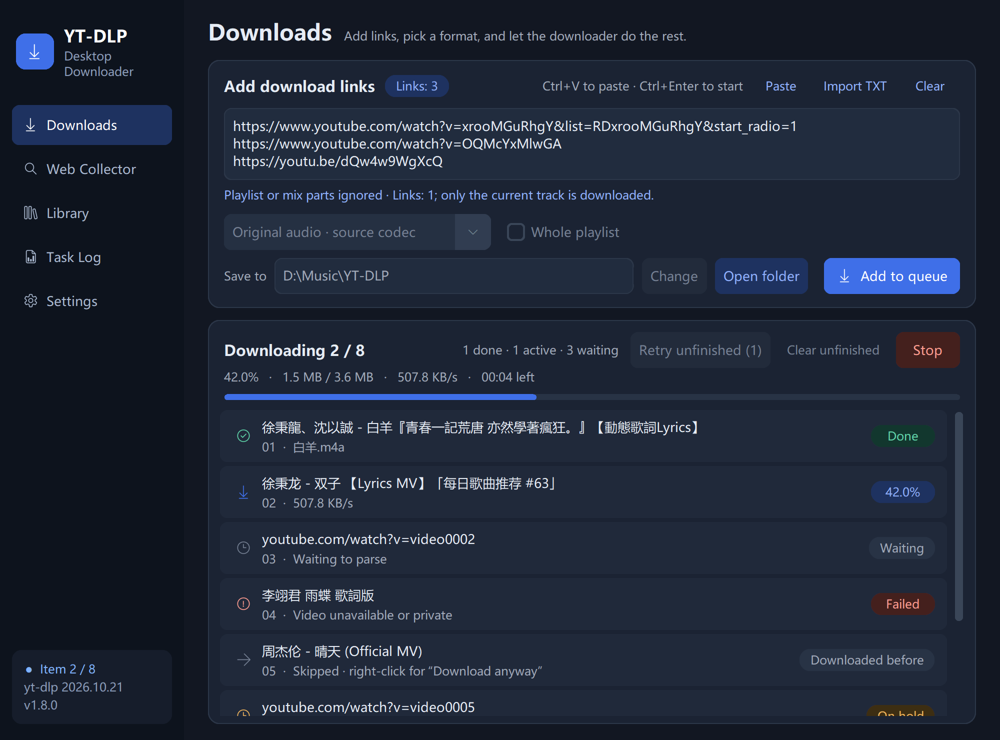
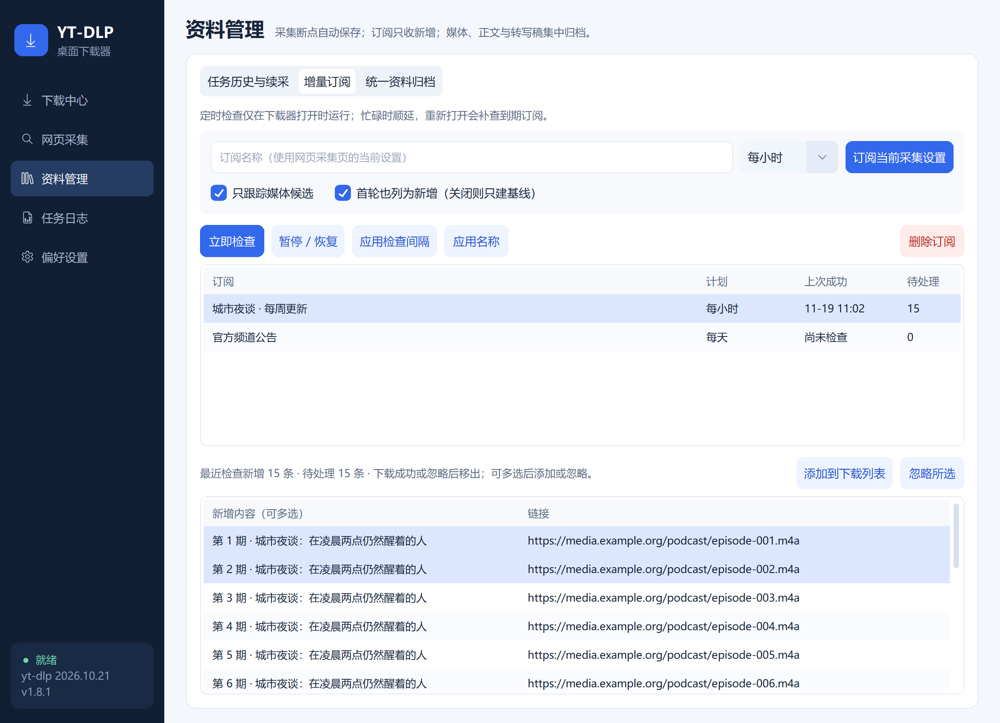

# YT-DLP Downloader / YT-DLP 下载器（ytdlp-desktop）

*简体中文说明在下方：[中文](#中文)。*

## English

YT-DLP Downloader is a Windows desktop front end for [yt-dlp](https://github.com/yt-dlp/yt-dlp): paste links, pick a format, press “Start download”. It also collects media links from web pages (Web Collector) and keeps a history, subscriptions and an archive of what you downloaded (Library). The interface is available in Simplified Chinese and English.

> This project is not affiliated with the yt-dlp project. Download only what you have the right to download, and follow each site's terms of use and copyright law.


### Highlights

- **Unattended runs survive the YouTube check**: when YouTube asks for verification, only the YouTube links wait and retry by themselves after 30, 15 and 15 minutes; downloads from other sites go on. Batches have a robust mode (pauses between items, automatic cool-down on HTTP 429).
- **More than a downloader**: the Web Collector finds media links on ordinary pages, pages that need scrolling and paged lists; the Library keeps task history, incremental subscriptions and one archive.
- **Nothing lost, nothing overwritten**: unfinished links survive a restart and can be retried in one click; existing files are never overwritten.
- **Ready to run, safe to update**: the packaged program brings yt-dlp, FFmpeg and Deno and needs no Python; a yt-dlp update is checked and test-run before it is used, and the built-in engine can always be restored; `install_release.py` checks every file before installing, self-tests the new version and restores the old one if that fails.
- **Private**: no usage data is collected or sent; cookie contents are never copied, stored or logged; proxy addresses are masked before anything is saved.
- **Chinese and English, easy to maintain**: follows the Windows language or a manual choice. Since 1.8.0 the program passes "message key + parameters" inside and looks the text up only when showing it, so a new sentence needs one entry per language, and checks in the tests catch the common ways a key gets missed (see "1.8.0: internal message keys" below).

### 1.8.0: internal message keys

1.8.0 adds no feature; it changes how the program passes texts around inside.

- Message keys instead of per-text translation patches: the core passes "message number + parameters" and the interface looks the text up in the running language; a new sentence needs one entry in the Chinese and one in the English catalog. The reverse lookup of 1.7.0 (`localize`, which turned the Chinese text back into a key on screen) is gone from the interface; texts that older versions stored without keys are recognised on reading by a frozen copy of that matcher.
- Guards that catch a missed key: a runtime sentinel in every test checks, on the paths the tests run, the texts the core emits or stores and the texts handed to show(), error_text() and t() (in English the Chinese text of a UI key counts too; seven 1.7.0 test files replace the core's emit with a plain function, so those events skip the sentinel); the English snapshot assertion (13), run with --all, checks that the captured pages show no Chinese outside user data; plus a closure check of everything older versions stored, an English replay of the old producers, and a static scan of the code against the rules in section 15 of MESSAGES.md. Run on the 1.7.0 code, they catch by themselves the three misses that took the 1.7.0 reviews three rounds to find: the titles 媒体直链 and 动态页面媒体请求 and the 1.5.1 collect errors without spaces. They catch the common ways a key gets missed, not every way of writing code: the static scan is a help, and the forms the reviews found it does not recognise are listed in section 12 (L-15, L-16).
- The known 1.7.0 English defects are fixed: the cookies-line error, reasons cut at 70 characters, raw yt-dlp output that was rewritten, and subscription errors containing “；” that were split apart. The English-only internal hints (such as "Unsupported output option") now have keys too; their Chinese text is still that English, as in 1.7.0.
- The Chinese interface is byte-identical to 1.7.0: every Chinese golden record is unchanged.
- Data untouched by the upgrade and readable by 1.7.0 / 1.6.0 / 1.5.1 after a rollback: the only addition is an extra JSON key that older versions ignore (checked with the code of those three versions).
- No new dependency, same privacy rules: cookie contents are never stored, proxy addresses are masked before anything is saved.
- Why 1.8.0 and not 2.0: the change was planned for 2.0 on the assumption that old versions could not read the new data. No old field changes, the keys sit in a field older versions ignore, and rollback works as before, so by the project's rule this is 1.8.0; 2.0 is kept for the day rollback to these versions is given up.

The design and the checks are described in [docs/1.8.0/spec/MESSAGES.md](docs/1.8.0/spec/MESSAGES.md).

### Install, update and roll back

- The program is a folder: `YT-DLP下载器.exe` and the `_internal` folder next to it must stay together (the exe alone does not start). Windows 10/11, 64-bit; no Python needed.
- Double-click `YT-DLP下载器.exe`; starting it again while it runs brings the open window to the front. The window remembers its size and position.
- To install a new build over an existing program folder, use `install_release.py` (developer tool, Chinese messages): it checks every file against the release record, keeps the previous version, runs a self-test from the new place and rolls back by itself when that fails. `--rollback` undoes one installation at a time; the 1.5.1 program is kept as `YT-DLP下载器-1.5.1备份.exe` and shares the settings, the Unfinished list and the library with this version.
- The bundled yt-dlp can be updated in Settings → Download engine (“Check for updates”); the new engine is checked (size, SHA256, it must start and accept every option this program uses) before it replaces the current one, and “Restore built-in engine” goes back.

### First download

1. Paste links into the link box on the Downloads page (Ctrl+V, “Paste” or “Import TXT”). Shared text from apps works too: the links are found in it and duplicates are merged.
2. Choose a format. Seven are offered: original audio (source codec), M4A (native AAC, no re-encoding), MP3 320 kbps, FLAC 24-bit, WAV 32-bit float, MP4 (most compatible, H.264) and MKV (source quality). Quality and “Embed subtitles” apply to the two video formats.
3. Press “Start download” (Ctrl+Enter). While a task runs the button reads “Add to queue”: new links join the running task.
4. Playlist and radio parameters in YouTube links are ignored unless “Whole playlist” is checked; auto-generated mixes (RD…) are never downloaded whole.
5. Files are named after the title (three naming styles in Settings → Files and naming); an existing file is never overwritten, a new one gets “ (2)”. Tags, the source link and cover art are written by default (WAV has no cover).
6. With “Skip items downloaded before” on (the default), a link downloaded before in the same format whose file is still there is skipped and shown as “Downloaded before”; right-click it and choose “Download anyway” to download it again.

### Unfinished links and retries

- Every link that did not finish is kept in the Unfinished list: failed, stopped, not started and links put on hold by the YouTube check. The list survives a restart and is shown below the task.
- “Retry unfinished (n)” (F5) retries them all with their own format, quality and save folder; right-click a row for “Retry this one”, “Show reason” or “Remove from list”; “Clear unfinished” empties the list after a confirmation (downloaded files stay).
- Steady mode (Settings → Batch downloads, on by default) waits 10–20 seconds between links. When a site answers HTTP 429 (rate-limiting), the whole queue pauses for a cool-down (5, then 10, at most 15 minutes, or the time the site asks for).

### The YouTube check and cookies

- YouTube sometimes asks the network you use to confirm that you are not a bot (“Sign in to confirm you're not a bot”). The other YouTube links of the task are put on hold (kept in the Unfinished list) while links of other sites go on. This usually clears in about 30 minutes; without cookies the program retries by itself after 30, 15 and 15 minutes.
- To go on at once, choose a Netscape-format `cookies.txt` of a signed-in YouTube account in Settings → Network. The program stores only the path of that file, never its content, and never writes its lines to the log. The file works like a login: keep it to yourself.

### Web Collector

- Enter up to 20 start pages (one per line) and press “Start collecting”. “Static page” mode reads the page directly; “Dynamic page (Chrome)” uses a separate temporary Chrome (it must be installed) and can scroll the page. Pages per site follow `rel=next` links on the same site only.
- The table lists media links (or all links); select some and press “Add to download list”: they go into the link box of the Downloads page and are never downloaded by themselves. “Export links (TXT)” and “Save page text” save the selection or the collected page text.
- “Save as subscription” turns the current settings into a subscription (see Library).

### Library

- **History & Resume**: every download and collection task, newest first (300 at a time, “Load more” for older ones, a search field for titles and links). “View results” loads a task again; “Resume unfinished” downloads the links of a task that did not succeed, or collects the pages that are left.
- **Subscriptions**: a subscription checks its start pages by hand or every 15 minutes, hourly or daily while the program is open, and lists only what is new. New items stay pending until they are downloaded successfully.
- **Archive**: with “Archive downloads in one place” on, downloads go into an archive folder you choose, one folder per item with its record, a readme, the page text and linked transcripts.
- When another program holds the library file (`library.sqlite3`), the window does not wait: it says so, keeps what it shows and writes the records once the file is free again.

### Settings

Download engine; Files and naming (naming style, tags, cover art, skipping items downloaded before); Network (proxy address, cookies); Batch downloads (Steady mode); Notifications and interface (notify when done, links in the clipboard, Appearance: Light / Dark / System, and Language); App and built-in components. Changes are saved at once.

**Language / 语言**: “System” uses Chinese when the Windows display language or the regional format is Chinese, and English otherwise; “简体中文” and “English” fix the language. A change applies after a restart: “Restart now” restarts the program and keeps the links in the box, the start pages of the Web Collector and a subscription name being typed (it waits while a task runs). The variable `YTDLP_DESKTOP_LANG=zh|en` overrides the choice for one session. The 1.5.1 fallback does not know this setting; after it saved the settings the choice is “System” again.

### Where your data lives

- `%LOCALAPPDATA%\YtDlpDesktop`: `settings.json`, `failed-downloads.json` (the Unfinished list), `download.log`, an updated engine and temporary files.
- `data\library.sqlite3` next to the program: history, download records, subscriptions and the archive index.
- Back up these, the `data` folder and your download and archive folders. Folder and file names stay Chinese in both languages: the default save folder `下载文件`, the archive folder `资料归档`, and in each archived item `资料信息.json`, `阅读说明.txt`, `网页正文.txt/.md`, `媒体` and `转写稿`. Their content (readme, page-text header) is written in the language the program runs in.

### Privacy

No usage data is collected or sent. The only background network request is at most one check a day for the newest yt-dlp version on `api.github.com` (it can be turned off and never installs anything). Of a cookies file only its path is stored.

| Web Collector | Library | Dark mode |
|---|---|---|
|  |  |  |

### From source, tests and builds

See the Chinese sections below for the commands (`prepare_vendor.py`, `src\app.py`, `verification\run_tests.py`, `build.py`); the manual `使用说明.txt` is in Chinese. The design of the two languages is in [docs/1.7.0/spec](docs/1.7.0/spec), the message keys of 1.8.0 in [docs/1.8.0/spec](docs/1.8.0/spec).

---

## 中文

一个基于 [yt-dlp](https://github.com/yt-dlp/yt-dlp) 的 Windows 桌面下载器：粘贴链接、选格式、点开始，剩下的交给它。另带网页采集和资料管理。界面有简体中文和英文两种。

> 本项目与 yt-dlp 官方项目无关。请只下载你有权下载的内容，并遵守各网站的使用条款和版权法律。


### 亮点

- **无人值守时也不怕 YouTube 验证**：YouTube 要求验证时，只暂缓 YouTube 链接，按 30、15、15 分钟倒计时自动重试；其他网站的下载照常进行。批量下载有稳健模式（条目间隔、遇到 429 自动冷却）。
- **不只是下载器**：网页采集能从普通网页、需要滚动的动态网页和翻页里找出音视频链接；资料管理有任务历史、增量订阅和统一归档。
- **任务不丢、文件不覆盖**：未完成的链接重启后还在，可一键重试；已有文件从不覆盖，重名自动加序号。
- **开箱即用、更新稳妥**：打包好的程序自带 yt-dlp、FFmpeg、Deno，不需要装 Python；更新 yt-dlp 前先核对校验值并试运行，随时能恢复内置版本；`install_release.py` 安装新版前逐个核对文件，装好后自检，失败自动恢复。
- **重视隐私**：不收集、不上传任何使用数据；cookies 内容从不复制、保存或写进日志；代理地址先屏蔽再保存。
- **中英文界面，维护简单**：默认跟随 Windows 语言，也可手动切换。1.8.0 起程序内部只传“消息编号 + 参数”，显示时按语言查表，新增一句话只需在中英文目录各加一条；测试中的检查会拦住常见的漏翻（详见下文“1.8.0：内部改用消息编号”）。

### 功能

**下载**
- 直接粘贴分享文本也可以，程序会自动提取链接、合并重复链接；电台和播放列表参数默认忽略，勾选“整个播放列表”才下载整个列表。
- 七种格式：原始音频、WAV、FLAC、MP3、M4A、MKV、MP4，视频可选分辨率；自动嵌入标签和封面（WAV 除外）。
- 文件名默认不带视频 ID，可选三种命名方式；已有文件从不覆盖，重名时自动加 “ (2)”。
- 下载中可以继续添加链接；可停止、重试单条、一键重试全部未完成；未完成列表在重启后保留。
- 稳健模式：条目之间间隔 10–20 秒，遇到 HTTP 429 自动冷却。
- YouTube 要求验证时，其余 YouTube 链接自动暂缓，并按 30、15、15 分钟倒计时自动重试；其他网站的下载不受影响。
- 可选 cookies.txt（Netscape 格式）和代理。

**网页采集与资料管理**
- 从网页发现音视频链接（普通网页、需要滚动的动态网页、翻页），筛选后加入下载列表，也可以保存网页正文。
- 资料管理：任务历史与续采、增量订阅、统一资料归档。

**界面与其他**
- 简体中文和英文两种界面：默认跟随 Windows（显示语言或区域格式是中文时用中文，否则用英文），也可以在“偏好设置 → 提醒与界面 → 语言”中选择，重启后生效（“立即重启”会保留链接框里的链接）。文件夹和文件名（“下载文件”“资料归档”等）在两种语言下都保持中文。
- 浅色、深色、跟随系统三种外观；适配 200% 高分屏。
- 引擎更新：可在设置里更新 yt-dlp，更新前会做兼容性检查，随时可恢复内置版本。
- 任务日志页，可只看错误、复制、打开日志文件。

| 网页采集 | 资料管理 | 深色模式 |
|---|---|---|
|  |  |  |

### 1.8.0：内部改用消息编号

1.8.0 没有新增功能，改的是程序内部传递文字的方式。

1. **不再逐条打补丁**：程序内部只传“第几号消息 + 参数”，界面显示时按当前语言查表；新增一句话只需在中英文目录各加一条。1.7.0 在界面上把中文原文反查回英文的那套做法（`localize` 和它的反查表）已经从界面里删掉；旧版本存下的、没有编号的文字，由一份冻结的 1.7.0 匹配器在读取时识别。
2. **同类问题由检查拦住**：全部测试中的运行时哨兵在测试走到的路径上检查核心发出的和写入存储的文字，以及交给 show / error_text 和 t() 显示的文字（英文界面下，界面文字的中文原文也会被记下；有七个沿用 1.7.0 的测试文件把核心的事件发送换成了普通函数，这些事件不经过哨兵）；英文快照的断言 (13)（--all 中运行）检查截取的页面上除用户数据外没有中文；另有旧版本存储文字的完整性检查、英文回放，以及按规范第 15 节规则检查代码的静态扫描。用这些检查回放 1.7.0 的旧代码，能自动抓到当时三轮审查才发现的“媒体直链”“动态页面媒体请求”和 1.5.1 旧格式采集错误。这些检查能抓住常见的漏编号，但不保证抓住每一种写法：静态扫描只是辅助，审查发现它还认不出的写法列在规范第 12 节 L-15、L-16。
3. **修复 1.7.0 英文界面的已知问题**：cookies 行格式错误的提示、被截成 70 字的原因、被误改写的 yt-dlp 原始输出、含“；”的订阅错误被拆坏，在英文界面都已改正（原因显示完整的英文，yt-dlp 的原始输出原样显示）；只有英文的内部提示（例如 “Unsupported output option”）也有了编号，中文目录里暂时仍是这句英文，与 1.7.0 相同。
4. **中文界面与 1.7.0 完全一致**：所有中文黄金记录逐字节不变。
5. **数据安全、可回退**：资料库、设置、未完成清单、失败清单和历史记录升级时不改写；新增的只是旧版本会忽略的附加字段；1.7.0 / 1.6.0 / 1.5.1 仍能照常读写同一份数据（已用这三个版本自己的代码验证）。
6. **不增加依赖，隐私规则不变**：cookies 内容从不记录，代理地址先屏蔽再保存。
7. **为什么是 1.8.0 而不是 2.0**：原先以为改用消息编号会改变数据格式、旧版本读不懂，所以打算留到 2.0；现在的做法没有改变任何旧字段，编号只放在旧版本会忽略的附加字段里，1.7.0 / 1.6.0 / 1.5.1 仍能读写同一份数据、可以照常回退，所以按项目规则是 1.8.0。2.0 留给将来决定不再支持回退到这些旧版本的那一天。

设计和检查的全部细节见 [docs/1.8.0/spec/MESSAGES.md](docs/1.8.0/spec/MESSAGES.md)。

### 隐私

- 不收集、不上传任何使用数据。
- 唯一的后台联网是每天最多一次向 `api.github.com` 查询 yt-dlp 的最新版本号（可在设置里关闭），从不自动安装。
- cookies 文件只记录它的路径，内容不会被复制、保存或写进日志。

### 从源码运行

需要 Windows 10/11（64 位）和 Python 3.11。

```powershell
py -3.11 -m venv .venv
.venv\Scripts\python.exe -m pip install -r requirements-lock.txt
.venv\Scripts\python.exe prepare_vendor.py      # 按 vendor.lock.json 下载 yt-dlp、FFmpeg、Deno 并校验 SHA-256
.venv\Scripts\python.exe -B src\app.py
```

动态网页采集需要本机安装 Google Chrome。

#### 第三方程序（vendor\）

`vendor\` 不在仓库里，由 `prepare_vendor.py` 生成：

- `vendor.lock.json`（随仓库提交）固定了每个程序的仓库、发布标签、文件名、下载地址和 SHA-256：yt-dlp 2026.10.21、Deno v2.9.8、FFmpeg 月末构建 autobuild-2026-10-31-18-18（FFmpeg-Builds 长期保留每月最后一个构建，每日构建约两周后删除）。许可证文件取自同一个标签。
- `prepare_vendor.py` 默认只下载锁定的版本，逐个核对 SHA-256，不符即停止且不改动 `vendor\`。压缩包缓存在 `build\vendor-cache`，`vendor\` 里不会留下 `*.zip` / `*.part`。`vendor\bin` 整体替换，旧版 FFmpeg 的 DLL 不会残留。
- `prepare_vendor.py --update` 查询最新的 yt-dlp、Deno 和最新一个月末 FFmpeg 构建，只改写 `vendor.lock.json`，不改动 `vendor\`。检查改动后再运行 `prepare_vendor.py` 按新锁准备 `vendor\`，然后提交新锁。
- `prepare_vendor.py --record-local` 不联网：把 `vendor\` 里现有的 yt-dlp.exe 和 `vendor\bin` 各文件的 SHA-256 记入 `vendor\manifest.json`。用于旧版 `prepare_vendor.py` 准备的 `vendor\`（它的清单没有文件列表，`build.py` 会拒绝并提示这一步）。同一个 FFmpeg 库有两个大版本号（例如 `avcodec-62.dll` 和 `avcodec-64.dll`）时，它拒绝记录：多出的是旧版 FFmpeg 残留的 DLL，删掉后再运行。
- `vendor\manifest.json` 记录 `vendor\` 里实际有什么：每个程序的版本（FFmpeg 另有 `display_version`）和文件列表及 SHA-256。`build.py` 和发布检查按这份列表核对 `vendor\bin`，不写死 FFmpeg 的 DLL 版本号；与 `vendor.lock.json` 不一致时只提示。

### 测试与打包

```powershell
.venv\Scripts\python.exe -X utf8 -B verification\run_tests.py          # 默认测试
.venv\Scripts\python.exe -X utf8 -B verification\run_tests.py --all    # 含真实引擎和采集的完整测试
.venv\Scripts\python.exe -B build.py                                   # 测试 + 打包 + 发布检查
```

测试在隔离的临时环境里运行，不会碰本机的设置和数据。`build.py` 从不下载，先按 `vendor\manifest.json` 核对 `vendor\`；结果在 `build\package-1.8.0\YT-DLP下载器`（程序文件夹，`YT-DLP下载器.exe` 和 `_internal` 必须放在一起）。发布检查通过后写 `build\verify\release-1.8.0.json`，其中列出程序文件夹里每个文件的路径、大小和 SHA-256，以及测试运行时哨兵的结果（必须没有违规）、遗留编号检查和旧版本源码的校验值。

`install_release.py` 用来把打包好的程序安全地装到已有的程序目录：先按发布记录逐个核对暂存的文件（发布检查之后改过、多出或缺少任何文件都拒绝安装），复制后再核对一次，然后备份旧版本，安装后自检，失败自动回退，并支持 `--rollback` 手动回退。

### 文档

- [使用说明.txt](使用说明.txt)：完整的用户说明。
- [架构说明.txt](架构说明.txt)：模块、事件流、数据文件和打包流程。
- [docs/1.6.0/spec](docs/1.6.0/spec)：1.6.0 版的设计规范。
- [docs/1.7.0/spec](docs/1.7.0/spec)：中英文界面的设计（I18N.md）和英文用词表（GLOSSARY.md）。
- [docs/1.8.0/spec](docs/1.8.0/spec)：内部消息编号的设计和检查（MESSAGES.md），以及设计时的两份文字流向图（map-download.md、map-collect-library.md）。

### 许可证

本项目代码使用 [MIT 许可证](LICENSE)。yt-dlp、FFmpeg、Deno、customtkinter、Scrapling 等第三方组件各自遵循它们自己的许可证；`prepare_vendor.py` 会把第三方许可证文件一并下载到 `vendor\licenses`（Python 依赖的许可证从 `.venv` 中已安装的包复制到 `vendor\licenses\python-packages`），打包时随程序一起分发。
