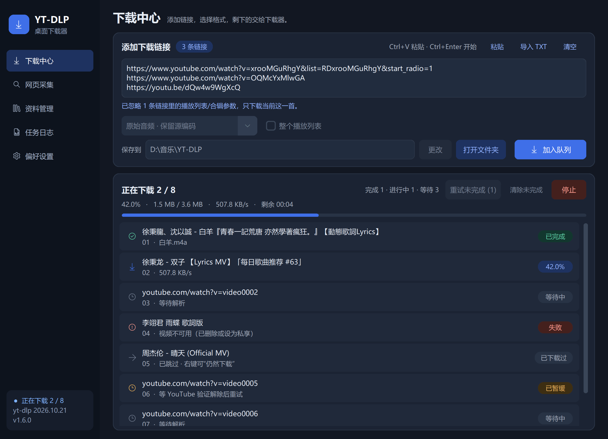

# YT-DLP 下载器（ytdlp-desktop）

一个基于 [yt-dlp](https://github.com/yt-dlp/yt-dlp) 的 Windows 中文桌面下载器：粘贴链接、选格式、点开始，剩下的交给它。另带网页采集和资料管理。

*A Chinese-language Windows desktop front end for yt-dlp: paste links, pick a format, download. Includes a web link collector and a download library. An English interface is planned for 1.7.0.*

> 本项目与 yt-dlp 官方项目无关。请只下载你有权下载的内容，并遵守各网站的使用条款和版权法律。


## 功能

**下载**
- 直接粘贴分享文本也可以，程序会自动提取链接、合并重复链接；电台和播放列表参数默认忽略，勾选“整个播放列表”才下载整个列表。
- 七种格式：原始音频、WAV、FLAC、MP3、M4A、MKV、MP4，视频可选分辨率；自动嵌入标签和封面（WAV 除外）。
- 文件名默认不带视频 ID，可选三种命名方式；已有文件从不覆盖，重名时自动加 “ (2)”。
- 下载中可以继续添加链接；可停止、重试单条、一键重试全部未完成；未完成列表在重启后保留。
- 稳健模式：条目之间间隔 10–20 秒，遇到 HTTP 429 自动冷却。
- YouTube 要求验证时，其余 YouTube 链接自动暂缓，并按 30、15、15 分钟倒计时自动重试；其他网站的下载不受影响。
- 可选 cookies.txt（Netscape 格式）和代理。

**网页采集与资料管理**
- 从网页发现音视频链接（普通网页、需要滚动的动态网页、翻页），筛选后加入下载列表，也可以保存网页正文。
- 资料管理：任务历史与续采、增量订阅、统一资料归档。

**界面与其他**
- 浅色、深色、跟随系统三种外观；适配 200% 高分屏。
- 引擎更新：可在设置里更新 yt-dlp，更新前会做兼容性检查，随时可恢复内置版本。
- 任务日志页，可只看错误、复制、打开日志文件。

| 网页采集 | 资料管理 | 深色模式 |
|---|---|---|
|  |  |  |

## 隐私

- 不收集、不上传任何使用数据。
- 唯一的后台联网是每天最多一次向 `api.github.com` 查询 yt-dlp 的最新版本号（可在设置里关闭），从不自动安装。
- cookies 文件只记录它的路径，内容不会被复制、保存或写进日志。

## 从源码运行

需要 Windows 10/11（64 位）和 Python 3.11。

```powershell
py -3.11 -m venv .venv
.venv\Scripts\python.exe -m pip install -r requirements-lock.txt
.venv\Scripts\python.exe prepare_vendor.py      # 按 vendor.lock.json 下载 yt-dlp、FFmpeg、Deno 并校验 SHA-256
.venv\Scripts\python.exe -B src\app.py
```

动态网页采集需要本机安装 Google Chrome。

### 第三方程序（vendor\）

`vendor\` 不在仓库里，由 `prepare_vendor.py` 生成：

- `vendor.lock.json`（随仓库提交）固定了每个程序的仓库、发布标签、文件名、下载地址和 SHA-256：yt-dlp 2026.10.21、Deno v2.9.8、FFmpeg 月末构建 autobuild-2026-10-31-18-18（FFmpeg-Builds 长期保留每月最后一个构建，每日构建约两周后删除）。许可证文件取自同一个标签。
- `prepare_vendor.py` 默认只下载锁定的版本，逐个核对 SHA-256，不符即停止且不改动 `vendor\`。压缩包缓存在 `build\vendor-cache`，`vendor\` 里不会留下 `*.zip` / `*.part`。`vendor\bin` 整体替换，旧版 FFmpeg 的 DLL 不会残留。
- `prepare_vendor.py --update` 查询最新的 yt-dlp、Deno 和最新一个月末 FFmpeg 构建，只改写 `vendor.lock.json`，不改动 `vendor\`。检查改动后再运行 `prepare_vendor.py` 按新锁准备 `vendor\`，然后提交新锁。
- `prepare_vendor.py --record-local` 不联网：把 `vendor\` 里现有的 yt-dlp.exe 和 `vendor\bin` 各文件的 SHA-256 记入 `vendor\manifest.json`。用于旧版 `prepare_vendor.py` 准备的 `vendor\`（它的清单没有文件列表，`build.py` 会拒绝并提示这一步）。同一个 FFmpeg 库有两个大版本号（例如 `avcodec-62.dll` 和 `avcodec-64.dll`）时，它拒绝记录：多出的是旧版 FFmpeg 残留的 DLL，删掉后再运行。
- `vendor\manifest.json` 记录 `vendor\` 里实际有什么：每个程序的版本（FFmpeg 另有 `display_version`）和文件列表及 SHA-256。`build.py` 和发布检查按这份列表核对 `vendor\bin`，不写死 FFmpeg 的 DLL 版本号；与 `vendor.lock.json` 不一致时只提示。

## 测试与打包

```powershell
.venv\Scripts\python.exe -X utf8 -B verification\run_tests.py          # 默认测试
.venv\Scripts\python.exe -X utf8 -B verification\run_tests.py --all    # 含真实引擎和采集的完整测试
.venv\Scripts\python.exe -B build.py                                   # 测试 + 打包 + 发布检查
```

测试在隔离的临时环境里运行，不会碰本机的设置和数据。`build.py` 从不下载，先按 `vendor\manifest.json` 核对 `vendor\`；结果在 `build\package-1.6.0\YT-DLP下载器`（程序文件夹，`YT-DLP下载器.exe` 和 `_internal` 必须放在一起）。发布检查通过后写 `build\verify\release-1.6.0.json`，其中列出程序文件夹里每个文件的路径、大小和 SHA-256。

`install_release.py` 用来把打包好的程序安全地装到已有的程序目录：先按发布记录逐个核对暂存的文件（发布检查之后改过、多出或缺少任何文件都拒绝安装），复制后再核对一次，然后备份旧版本，安装后自检，失败自动回退，并支持 `--rollback` 手动回退。

## 文档

- [使用说明.txt](使用说明.txt)：完整的用户说明。
- [架构说明.txt](架构说明.txt)：模块、事件流、数据文件和打包流程。
- [docs/1.6.0/spec](docs/1.6.0/spec)：1.6.0 版的设计规范。

## 许可证

本项目代码使用 [MIT 许可证](LICENSE)。yt-dlp、FFmpeg、Deno、customtkinter、Scrapling 等第三方组件各自遵循它们自己的许可证；`prepare_vendor.py` 会把第三方许可证文件一并下载到 `vendor\licenses`（Python 依赖的许可证从 `.venv` 中已安装的包复制到 `vendor\licenses\python-packages`），打包时随程序一起分发。
