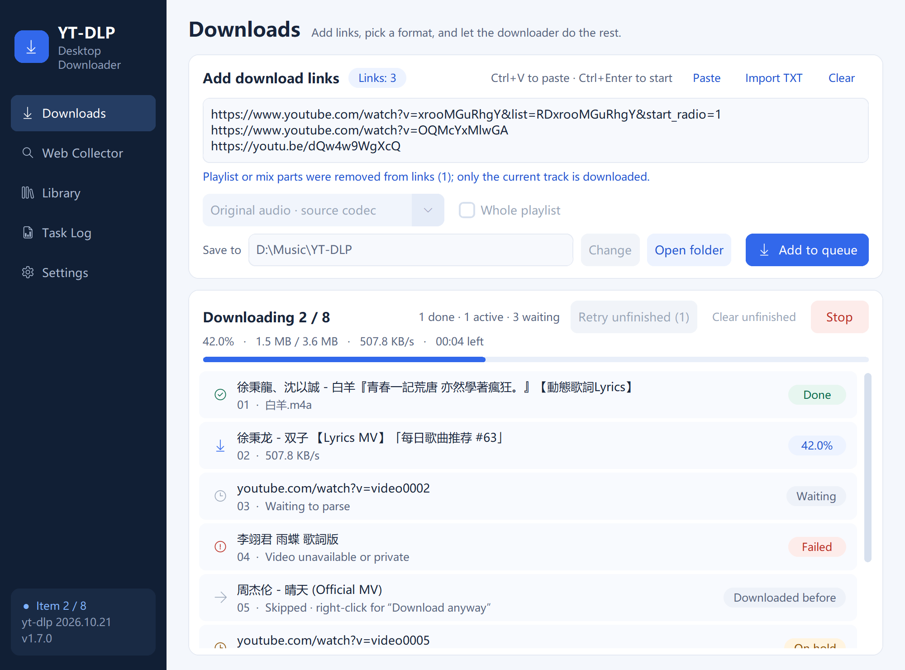
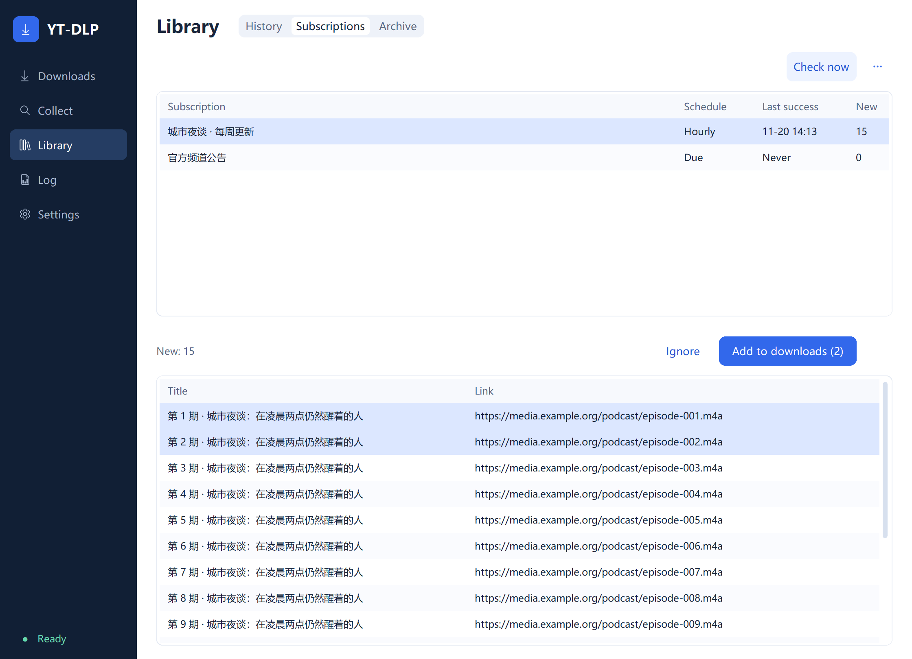
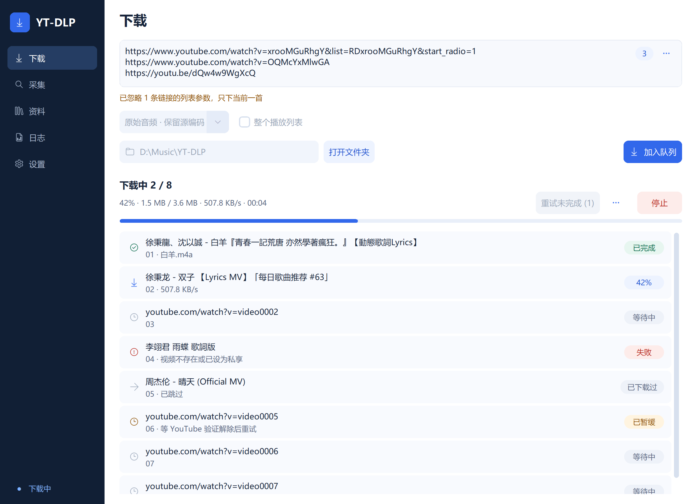
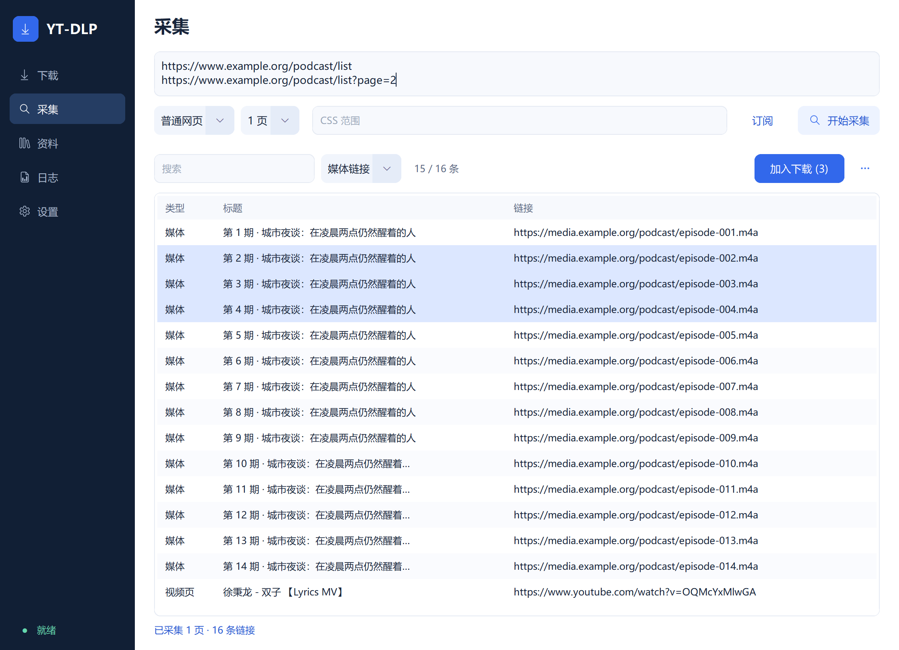
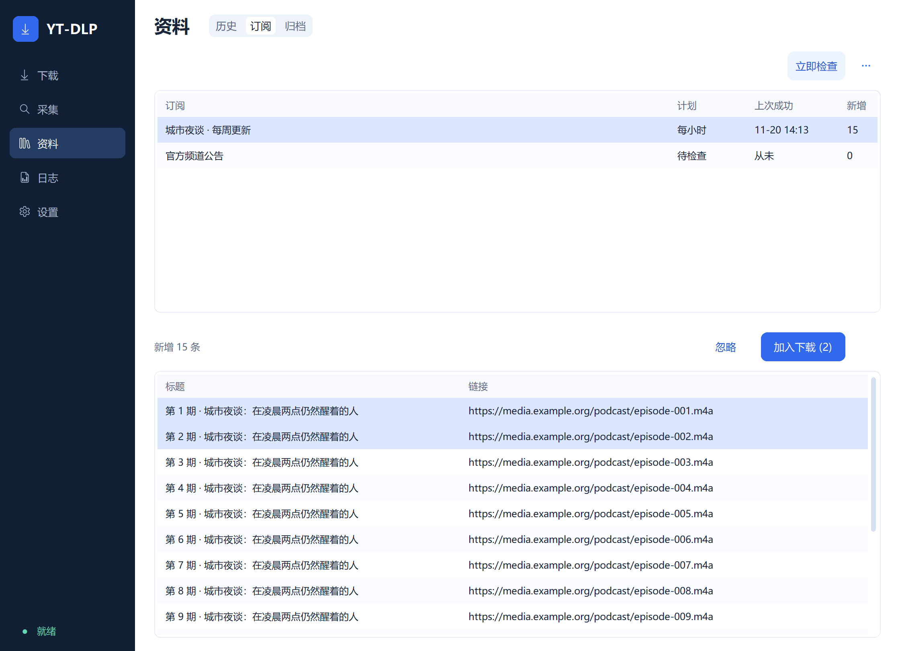

# YT-DLP Downloader / YT-DLP 下载器

[English](#english) · [中文](#中文)

## English

A Windows desktop app for [yt-dlp](https://github.com/yt-dlp/yt-dlp): paste links, pick a format, download. English and Simplified Chinese.



### Features

- **Waits out YouTube's check.** When YouTube asks to confirm you are not a bot, the remaining YouTube links are held instead of tried; other sites keep downloading. Without a cookies file, held links are retried after 30, 15 and 15 minutes, or at once with Retry now.
- **Backs off on rate limits.** On HTTP 429 a link is retried after 5, then 10 minutes; if it is still refused, it fails and the queue pauses 15 minutes before the next link. A longer `Retry-After` from the server is honored. Steady mode (on by default) spaces downloads 10–20 s apart.
- **Loses no links.** Links that did not finish stay in Unfinished across restarts, each with its own format, folder and options; Retry unfinished (F5) runs them again.
- **Collects links from pages.** Static or dynamic pages (dynamic uses a separate, temporary Chrome and can scroll); up to 20 page links at once, each followed along same-site `rel=next` for up to 5 pages. You pick what goes to Downloads; Subscribe saves these settings as a subscription.
- **Checks subscriptions** by hand, every 15 minutes, hourly or daily while the app is open. New items stay listed until downloaded or ignored.
- **One archive.** With Archive downloads on, every item gets its own folder by site and ID: media, page text (TXT and MD), item info and transcripts.
- **Safe engine updates.** A new yt-dlp comes only from its official GitHub release, must match the release's size and SHA-256, and must run with the options this app uses before it replaces the current one. Restore built-in engine goes back.
- **Private.** No usage data. The proxy lives for this session only and shows as `[proxy]` in logs. Of a cookies file only the path is saved, and its contents never reach the log. Watch clipboard only offers the links it finds: it never fills the box, starts a download or stores the text. Besides what you start or schedule, the only network request is a daily version check on `api.github.com`; it installs nothing and can be turned off.
- **Bundled engine.** yt-dlp, FFmpeg and Deno ship with the program, pinned by version and SHA-256 in `vendor.lock.json`.

| Collect | Subscriptions |
|---|---|
|  |  |

### New in 2.0

- A cleaner interface: one-word navigation, title-only headers, explanations moved to the manual.
- A new data format. History, subscriptions and the Unfinished list written by 1.x are not read: at first start each file is renamed (`….bad-<time>…`) and left where it is, the app starts empty, and the Log page says which file was kept. Archive info files are set aside (`资料信息.bad.json`) when their item is next written. Most settings carry over; format and resolution go back to their defaults, and the language follows Windows again. Downloaded files are not touched.

### Use

Download `ytdlp-desktop-<version>-win64.zip` from [Releases](https://github.com/Andy-vortex/ytdlp-desktop/releases), unzip it to a folder you can write to (Desktop or Downloads, not Program Files) and run `YT-DLP下载器.exe` in the `YT-DLP下载器` folder. Keep the exe and `_internal` together. The program is not code-signed: on the first start Windows may show "Windows protected your PC"; click More info, then Run anyway. Windows 10/11, 64-bit. Dynamic collection needs Google Chrome installed.

| Data | Location |
|---|---|
| Settings, Unfinished list, log | `%LOCALAPPDATA%\YtDlpDesktop` |
| History, subscriptions, archive index | `%LOCALAPPDATA%\YtDlpDesktop\library.sqlite3`; `data\library.sqlite3` next to the program instead, when that file exists and can be written |

The manual is [使用说明.txt](使用说明.txt) (Chinese).

### Build and test

Python 3.11, from the repository root:

```powershell
py -3.11 -m venv .venv
.venv\Scripts\python.exe -m pip install -r requirements-lock.txt
.venv\Scripts\python.exe -X utf8 -B prepare_vendor.py
.venv\Scripts\python.exe -X utf8 -B verification\sandbox_app.py
```

```powershell
.venv\Scripts\python.exe -X utf8 -B verification\run_tests.py --quick
.venv\Scripts\python.exe -X utf8 -B verification\run_tests.py -k urls,unfinished
.venv\Scripts\python.exe -X utf8 -B verification\run_tests.py -j 4
.venv\Scripts\python.exe -X utf8 -B verification\run_tests.py --all
.venv\Scripts\python.exe -X utf8 -B build.py
.venv\Scripts\python.exe -X utf8 -B install_release.py --stage build\package-<version>\YT-DLP下载器 --target "<program folder>" --dry-run
```

- `prepare_vendor.py` downloads the pinned yt-dlp, FFmpeg and Deno, and the license texts of the libraries inside the Python runtime and packages, into `vendor\` and stops on any SHA-256 mismatch.
- `sandbox_app.py` starts the app in a temporary folder, so your settings and data stay untouched.
- `run_tests.py` runs every test file in its own sandbox. `--quick` is the fast subset with no windows; `-k` picks files by name; `-j N` runs N files at once; `--all` adds the real engine, a local test server and Chrome.
- `build.py` runs `--all` serially, packages `build\package-<version>\YT-DLP下载器` with `THIRD-PARTY.txt`, tests the packaged exe, writes `build\verify\release-<version>.json` with every file's size and SHA-256, then `build\ytdlp-desktop-<version>-win64.zip` and its `.sha256`. The release gate accepts only serial runs of the current sources and tests.
- `install_release.py` checks every file against that record, keeps the previous version, self-tests the new one and rolls back if the test fails. Drop `--dry-run` to install.

| Path | Contents |
|---|---|
| `src\` | the app; `app.py` is the entry point; `i18n_*.py` hold every interface text in both languages |
| `verification\` | tests, `run_tests.py`, `sandbox_app.py` |
| `docs\ARCHITECTURE.md` | modules, events, data files, packaging |
| `docs\DATA.md` | the data file formats |
| `AGENTS.md` | rules for contributors and coding agents |

Design records of 1.x are in the tag `v1.8.1`.

### License

[MIT](LICENSE). yt-dlp, FFmpeg, Deno, the Python runtime and the other bundled components keep their own licenses: `THIRD-PARTY.txt` in the program folder lists each with its version, license, source and where its license text is (most are in `_internal\vendor\licenses`). The bundled FFmpeg is a GPL build (GPL-3.0-or-later); its entry names the FFmpeg commit and the build scripts. Not affiliated with the yt-dlp project; download only what you have the right to.

---

## 中文

基于 [yt-dlp](https://github.com/yt-dlp/yt-dlp) 的 Windows 桌面下载器：粘贴链接，选格式，下载。界面有简体中文和英文。



### 特点

- **YouTube 验证时自动等待。** YouTube 要求“确认不是机器人”时，余下的 YouTube 链接暂缓、不再尝试；其他网站照常下载。没有设置 cookies 时，暂缓的链接在 30、15、15 分钟后自动重试，也可以点“立即重试”。
- **遇到限流会退让。** 遇到 HTTP 429，该链接在 5 分钟、再 10 分钟后重试；仍被拒绝就记为失败，整个队列暂停 15 分钟再继续下一条。服务器给出更长的 `Retry-After` 时按它等待。稳健模式（默认开启）让两次下载间隔 10–20 秒。
- **链接不丢。** 没完成的链接留在“未完成”里，重启后还在，各自保留格式、文件夹和选项；“重试未完成”（F5）重新下载。
- **从网页采集链接。** 普通或动态网页（动态采集使用独立的临时 Chrome，可以滚动）；一次最多 20 个网页链接，每个连同同站 `rel=next` 的后续页最多 5 页。由你挑选哪些加入下载；“订阅”把这些设置存为订阅。
- **检查订阅。** 程序打开时可手动、每 15 分钟、每小时或每天检查。新增保留到下载成功或忽略。
- **统一归档。** 开启“统一归档”后，每个条目按站点和 ID 各占一个文件夹：媒体、正文（TXT 和 MD）、资料信息、转写稿。
- **引擎更新稳妥。** 新版 yt-dlp 只从官方 GitHub 发布页获取，大小和 SHA-256 必须与发布信息一致，并且能带着本程序使用的选项正常运行，才会替换当前版本。“恢复内置引擎”可退回。
- **隐私。** 不收集使用数据。代理只在本次运行有效，日志里显示为“[代理]”。cookies 文件只保存路径，文件内容不会进入日志。“识别剪贴板”只提示找到的链接，不自动填入、不开始下载、不保存内容。除了你自己启动或安排的任务，唯一的联网是每天一次向 `api.github.com` 查询版本号；它不安装任何东西，可以关闭。
- **自带引擎。** yt-dlp、FFmpeg、Deno 随程序提供，版本和 SHA-256 锁定在 `vendor.lock.json`。

| 采集 | 订阅 |
|---|---|
|  |  |

### 2.0 的变化

- 界面更干净：导航只有单词，页头只有标题，说明文字移进使用说明。
- 数据格式更新。1.x 写的历史、订阅和未完成清单不再读取：首次启动时各自改名（`….bad-<时间>…`）留在原处，程序从空白开始，日志页写明哪个文件被保留。归档里的资料信息文件在该条目下次写入时改名保留（`资料信息.bad.json`）。大部分设置沿用；格式、分辨率回到默认，语言重新跟随 Windows。已下载的文件不受影响。

### 使用

从 [Releases](https://github.com/Andy-vortex/ytdlp-desktop/releases) 下载 `ytdlp-desktop-<版本>-win64.zip`，解压到自己能写入的文件夹（桌面或“下载”，不要放进 Program Files），运行 `YT-DLP下载器` 文件夹里的 `YT-DLP下载器.exe`。exe 和 `_internal` 要放在一起。程序没有代码签名：第一次运行时 Windows 可能提示“Windows 已保护你的电脑”，点“更多信息”，再点“仍要运行”。Windows 10/11 64 位。动态采集需要安装 Google Chrome。

| 数据 | 位置 |
|---|---|
| 设置、未完成清单、日志 | `%LOCALAPPDATA%\YtDlpDesktop` |
| 历史、订阅、归档索引 | `%LOCALAPPDATA%\YtDlpDesktop\library.sqlite3`；程序旁的 `data\library.sqlite3` 已存在且可写时用那个 |

使用说明见 [使用说明.txt](使用说明.txt)。

### 构建与测试

Python 3.11，在仓库根目录：

```powershell
py -3.11 -m venv .venv
.venv\Scripts\python.exe -m pip install -r requirements-lock.txt
.venv\Scripts\python.exe -X utf8 -B prepare_vendor.py
.venv\Scripts\python.exe -X utf8 -B verification\sandbox_app.py
```

```powershell
.venv\Scripts\python.exe -X utf8 -B verification\run_tests.py --quick
.venv\Scripts\python.exe -X utf8 -B verification\run_tests.py -k urls,unfinished
.venv\Scripts\python.exe -X utf8 -B verification\run_tests.py -j 4
.venv\Scripts\python.exe -X utf8 -B verification\run_tests.py --all
.venv\Scripts\python.exe -X utf8 -B build.py
.venv\Scripts\python.exe -X utf8 -B install_release.py --stage build\package-<版本>\YT-DLP下载器 --target "<程序目录>" --dry-run
```

- `prepare_vendor.py` 按锁定版本把 yt-dlp、FFmpeg、Deno，以及 Python 运行库和各个包里所含库的许可文本下载到 `vendor\`，SHA-256 不符即停止。
- `sandbox_app.py` 在临时文件夹里启动程序，不碰本机设置和数据。
- `run_tests.py` 让每个测试文件在自己的沙箱里运行。`--quick` 是不开窗口的快速子集；`-k` 按名字选文件；`-j N` 同时跑 N 个文件；`--all` 另含真实引擎、本地测试服务器和 Chrome。
- `build.py` 串行运行 `--all`，打包到 `build\package-<版本>\YT-DLP下载器`（附 `THIRD-PARTY.txt`），测试打包后的 exe，写出记录每个文件大小和 SHA-256 的 `build\verify\release-<版本>.json`，再生成 `build\ytdlp-desktop-<版本>-win64.zip` 和它的 `.sha256`。发布门禁只接受对当前源码和测试的串行运行。
- `install_release.py` 按这份记录逐个核对文件，保留上一版，安装后自检，失败即回滚。去掉 `--dry-run` 即正式安装。

| 路径 | 内容 |
|---|---|
| `src\` | 程序；入口是 `app.py`；`i18n_*.py` 存放全部界面文字（中英文） |
| `verification\` | 测试、`run_tests.py`、`sandbox_app.py` |
| `docs\ARCHITECTURE.md` | 模块、事件、数据文件、打包 |
| `docs\DATA.md` | 数据文件的格式 |
| `AGENTS.md` | 给贡献者和编程智能体的规则 |

1.x 的设计记录在标签 `v1.8.1` 里。

### 许可证

[MIT](LICENSE)。yt-dlp、FFmpeg、Deno、Python 运行库等随附组件遵循各自的许可证：程序文件夹里的 `THIRD-PARTY.txt` 逐一列出版本、许可证、源码地址和许可文本的位置（大部分在 `_internal\vendor\licenses`）。随附的 FFmpeg 是 GPL 构建（GPL-3.0-or-later），它那一条写明了 FFmpeg 的提交号和构建脚本。本项目与 yt-dlp 官方无关；请只下载你有权下载的内容。
